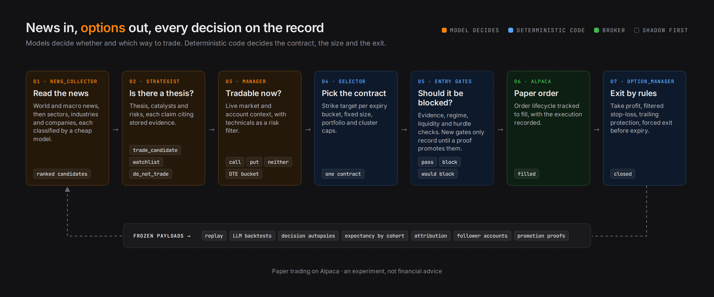

# Agentic Trading Experiment

This public repository intentionally keeps demo-safe defaults. Production-tuned prompts, private source lists, live runtime artifacts, planning notes and real credentials are excluded or simplified here.

An options paper-trading system where language models read the news and decide *whether* and *in which
direction* to trade, and plain, deterministic Python decides *which contract, how much and when to exit*.
Every decision is saved with the exact evidence it saw, so it can be audited, replayed and measured later.



It trades on an Alpaca **paper** account. It is an experiment, not financial advice and not production
trading software.

## How it works

```text
news_collector   scrape news, classify it top-down: world/macro -> sectors -> industries -> companies
      |
worker           rank candidate companies, then for each one:
      |            strategist (LLM)  trade_candidate / watchlist / do_not_trade, citing stored articles
      |            manager (LLM)     call / put / neither, plus a days-to-expiry bucket
      |            contract selection and risk caps (deterministic)
      |            entry gates, most running in shadow mode
      |            Alpaca paper order
      |
option_manager   watch open positions and exit on deterministic rules (DTE, stop-loss, profit protection)
      |
api + dashboard  React dashboard over a Flask API and SQLite
```

[STRATEGY.md](STRATEGY.md) walks through the strategy in plain language, and
[docs/SYSTEM_DIAGRAM.md](docs/SYSTEM_DIAGRAM.md) draws each part of the system from the code.

## What's worth a look

- **Grounded decisions.** Model outputs must cite the stored articles and evidence they rely on, and the
  citations are checked in code before anything trades.
- **Frozen payloads and replay.** The exact input each stage decided on is saved at decision time, so past
  decisions can be replayed against new prompts or models in LLM backtests.
- **Shadow gates with promotion proofs.** New entry rules start by only recording what they *would* have
  blocked. A rule is enforced only after a pre-registered proof shows it helps on real outcomes.
- **Measurement built in.** Decision autopsies, expectancy by cohort, decision attribution, news lag, and
  follower paper accounts that mirror production into other strategies (spreads, in-the-money, longer
  expiry, shares).
- **Evidence-first research.** SEC filings, issuer releases and analyst consensus are collected into dated
  evidence packages. A discovery and research pipeline runs in shadow and never places orders.
- **Evidence Exposure Map and Demo Mode.** An interactive map from a news article to the sector, industry,
  company and current option exposure it touches, with a seeded demo that needs no credentials.

## Quick start

You need Docker, an [Alpaca](https://alpaca.markets) paper-trading account and one model provider.

```bash
cp .env.example .env
```

Fill in `PUBLIC_KEY` and `PRIVATE_KEY` (Alpaca paper keys), then choose a model provider:

- **Vertex AI** (default): set `GOOGLE_CLOUD_PROJECT` and `GOOGLE_CLOUD_LOCATION` and sign in with
  Application Default Credentials.
- **Ollama** (local): set `LLM_PROVIDER=ollama` and start with `--profile ollama`.
- **OpenAI**: set `LLM_PROVIDER=openai` and `OPENAI_API_KEY`.

```bash
docker compose up --build
```

Open `http://localhost`. To look around without any keys, open Demo Mode at
`http://localhost/#/decisions/map?demo=1`. It uses seeded fictional data and places no orders.

[docs/DEPLOYMENT.md](docs/DEPLOYMENT.md) covers every service, option-quote data, HTTPS on a public server,
Vertex authentication, the API endpoints and startup telemetry.

## Development

```bash
pip install -e ".[dev]" -c constraints.txt
python3 scripts/project.py test                       # Python test suite
cd web_dashboard && npm ci && npm test && npm run build
```

See [docs/DEVELOPMENT.md](docs/DEVELOPMENT.md) for import roots, selected tests and CI.

## Repository layout

| Path | What it holds |
| --- | --- |
| `Python Scripts/` | worker, option manager and news collector entrypoints; LLM stages (`agentCallers/`); trading, research and runtime services (`services/`); news collection (`Webscraping/`) |
| `Data/` | SQLite schemas and the database modules |
| `api.py`, `api_routes/`, `api_support/` | Flask API for the dashboard |
| `web_dashboard/` | React + Tailwind + daisyUI dashboard |
| `scripts/` | operator and research command-line tools |
| `tests/` | Python test suite |
| `docs/` | documentation, indexed in [docs/README.md](docs/README.md) |

[docs/CODE_MAP.md](docs/CODE_MAP.md) maps the repository in detail, [docs/ARCHITECTURE.md](docs/ARCHITECTURE.md)
says where new code belongs, and [GLOSSARY.md](GLOSSARY.md) defines the domain terms.

## Background

The project was extended during OpenAI Build Week in July 2026 with the Exposure Map, decision autopsies and
Demo Mode. [docs/BUILD_WEEK.md](docs/BUILD_WEEK.md) describes that work.

## License and contact

Licensed under the [GNU GPL v3](LICENSE). Optional startup telemetry is described in [PRIVACY.md](PRIVACY.md).

Feedback and collaboration are welcome, especially on risk management for options, LLM-driven decision
systems and deterministic contract selection:

- GitHub: https://github.com/GeorgeStatho
- LinkedIn: www.linkedin.com/in/george-stathopoulos-0601b1229
- Email: georgestathopou [at] gmail [dot] com
