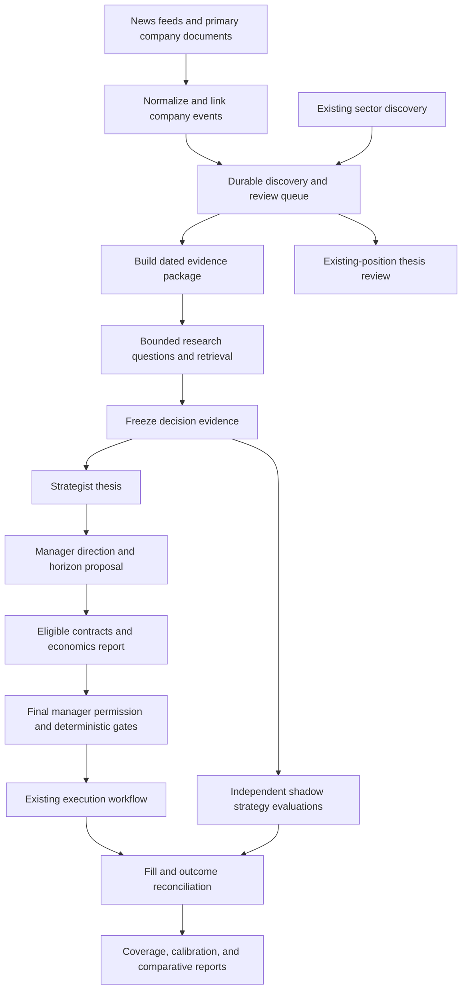

# Evidence, discovery, and trade decision implementation plan

Status: Phases 0–5 implemented; Phases 6–7 remain proposed. See
[Phase 0 implementation and operating notes](RESEARCH_PHASE0.md) and
[Phase 1 implementation, coverage limits, and setup](RESEARCH_PHASE1.md), plus
[Phase 2 queue and shadow discovery operating notes](RESEARCH_PHASE2.md),
[Phase 3 bounded research operating notes and retrieval limits](RESEARCH_PHASE3.md), and
[Phase 4 structured thesis, claim checks, and design decisions](RESEARCH_PHASE4.md), and
[Phase 5 trade economics, finalization, and submission rechecks](RESEARCH_PHASE5.md).

## Objective

Extend the existing news → strategist → manager → options workflow so it can discover material company events, investigate missing information, form falsifiable investment theses, and evaluate whether a particular trade is attractive after costs.

Deliver the first complete workflow for **earnings announcements and guidance changes**. Expand to other catalyst families only after that workflow is operational and measurable.

The system should be able to explain: what changed, what was previously expected, why the change matters to this company, what evidence contradicts the thesis, when the thesis should play out, what would invalidate it, and whether the available option expresses it economically.

## Scope and boundaries

Implement:

- Historical company evidence packages with source and availability timestamps.
- Event-driven discovery alongside existing sector/industry discovery.
- A durable candidate/review queue with bounded processing budgets.
- A bounded research loop using approved retrieval operations.
- Structured theses with claim-level evidence and explicit unknowns.
- Deterministic trade-economics reports integrated before final execution permission.
- Comparable shadow evaluations and an operational outcome collection loop.
- Read-only diagnostics for coverage, research progress, decisions, and outcomes.

Defer a general portfolio optimizer, new asset classes, autonomous strategy tuning, and broad coverage of every catalyst family. Preserve existing exposure, position-count, premium, scheduling, and broker controls. Event-triggered thesis reviews are included as a downstream consumer of the discovery queue, but new exit authority is a separate rollout decision.

Follow [ARCHITECTURE.md](ARCHITECTURE.md) and [FEATURE_PLAYBOOK.md](FEATURE_PLAYBOOK.md). New logic belongs in the preferred packages, not compatibility wrappers.

## Existing implementation to extend

| Concern | Current integration points | Required extension |
| --- | --- | --- |
| Ingestion | `Python Scripts/news_collector_main.py`, `Webscraping/pipelines/`, `Data/news_db_modules/` | Discover supported company events independently of sector rankings; capture primary documents |
| Event identity | `Data/catalyst_models.py`, `Data/catalyst_schema.sql`, `Data/news_db_modules/provenance.py` | Reuse catalysts and root events; version event evidence instead of duplicating identities |
| Candidate selection | `agent_pipeline/target_selection.py`, `agent_pipeline/existing_db_view.py`, `agentCallers/main.py` | Merge event, watchlist, position-review, and sector candidates |
| Evidence input | `agent_builders/strategist_payload.py`, `strategist_payload_company.py`, `agent_contracts.py` | Add immutable evidence packages and research status |
| Reasoning | `agent_stages/strategist_*`, `agent_stages/manager_*` | Extend schemas, validation, and handoff; retain backward-compatible fields |
| Economics | `services/pricing_gates.py`, `option_hurdle_gate.py`, `scenario_selector.py`, `pricing_policy.py` | Add explicit coverage and net-outcome reports; validate assumptions before enforcement |
| Execution | `services/order_candidates.py`, `trade_executor.py`, `front_main_application.py` | Carry report identities and recheck validity before submission |
| Review | `services/thesis_validator_service.py`, `thesis_evidence_pack.py`, `thesis_arbiter.py` | Consume material-event reviews without bypassing deterministic exit controls |
| Evaluation | `Data/market_db_modules/research_runs.py`, `research_reports.py`, `services/research_inputs.py`, `shadow_portfolio.py` | Compare strategy evaluations on shared observations; collect forward outcomes |

Paths beginning with `agent_*` are relative to `Python Scripts/agentCallers/`; `services/` paths are relative to `Python Scripts/`.

Current constraints to account for:

- Sector/industry discovery counts high-confidence impacts; selected companies are drawn from a market-weight-ordered list.
- The existing admission filter in `agentCallers/main.py` expects opportunist support. Adding event candidates without adapting this filter would still exclude them.
- Pricing gates are shadow-only, and several V2 enforcement modes require matching promotion evidence. This plan does not activate them by changing environment variables.
- Contract pricing currently follows the manager call. Final permission must move after economics, or be implemented as a separate finalization step.
- Streaming execution calls `on_manager_result` immediately. That callback must receive only finalized results.
- Candidate IDs are strategy-specific, but replacement promotion currently joins evaluations on candidate ID. This must be repaired before meaningful challenger promotion.

## Target workflow



## Data contracts and persistence

Use additive, idempotent migrations with indexes and explicit foreign keys. Re-export stable database functions through the existing database facades. Names below are proposed; reuse an equivalent existing table where practical.

### Evidence and company facts

| Proposed record | Required fields and behavior |
| --- | --- |
| `evidence_documents` | Immutable document ID/version, provider, source URL, publisher, document type, content hash, stored text or durable content reference, publication time, first-observed time, ingestion time, superseded-document reference |
| `company_facts` | Company ID, metric, value or range, units/currency/scale, fiscal period, period type, accounting basis, source document ID, source span, extraction version, availability time, revision link |
| `evidence_packages` | Package ID, company ID, catalyst/event revision, cutoff time, fact/document IDs, supporting/opposing claims, gaps, freshness/coverage status, schema version, immutable content hash |
| `research_sessions` | Queue item, package versions, status, calls and cost consumed, deadline, stop reason, model/prompt versions |
| `research_steps` | Session ID, question, typed operation/arguments, result evidence IDs, timestamps, validation result, error/retry details |

Facts must distinguish actuals, prior guidance, updated guidance, analyst estimates, and derived calculations. Never compare GAAP EPS with adjusted EPS, quarterly revenue with annual guidance, or currencies/scales without explicit normalization. Persist the inputs and formula for derived values.

Unknown values are null plus a reason, never zero. If consensus is unavailable, report that limitation; a guidance change is not automatically a surprise relative to market expectations.

### Discovery and comparison identities

| Proposed record | Required fields and behavior |
| --- | --- |
| `discovery_queue` | Company, catalyst, evidence revision, purpose, origin, priority components, status, attempts, next-attempt time, lease owner/expiry, completion/deferral reason |
| `research_observations` | Strategy-independent observation ID, company/event revision, frozen source snapshot, information cutoff, evaluation protocol version, content hash |
| `strategy_evaluations` | Observation ID, strategy/run/manifest ID, strategy-specific candidate ID, input/output hashes, status including explicit abstention or unavailable evaluation |
| `candidate_economics_reports` | Candidate ID, optional evidence package, quote snapshot, forecast/scenario version, contract-level outcomes, costs, coverage, validity conditions, report hash |

Queue idempotency key: company + catalyst + material evidence revision + review purpose. Retries reuse that item. New substantive evidence creates a new revision; syndicated copies do not.

An observation ID must not include a model, strategy configuration, or candidate ID. Match comparative results using the same observation and evaluation protocol, with separate candidate IDs for each strategy.

### Time semantics

- Store timezone-aware UTC timestamps; preserve provider timestamps and precision.
- Live decisions may use only evidence actually obtained by the system by the decision cutoff. Publication time alone does not establish local availability.
- Distinguish the event's economic date, source publication date, local first-observed date, and retrieval date.
- A research session can acquire evidence after its initial snapshot. Freeze a new package at completion and update the decision cutoff; do not attach new evidence to an older cutoff.
- Reject an outdated session if a material event revision supersedes it before decision finalization.
- Never overwrite an earlier fact with a restatement or a revised consensus snapshot.
- Historical provider data imported later must be labeled as reconstructed history, not actual historical system knowledge. Keep it separate from untouched forward evaluation.

## Implementation phases

### Phase 0 — Establish contracts, migration behavior, and comparison identity

Deliver this foundation before adding new model behavior.

- [x] Add evidence/observation/queue schemas and database modules; test repeated initialization on empty and existing databases.
- [x] Add typed contracts for facts, evidence packages, queue items, research sessions, and economics reports. (Phase 5 replaced the economics contract with `candidate_economics_reports`.)
- [x] Add shared observation linkage to candidates/evaluations without rewriting existing candidate IDs or immutable snapshots.
- [x] Update research enrollment and replacement comparison to use observation identity, not equality of strategy-specific candidate IDs.
- [x] Separate evaluator/source version checks from strategy manifest checks. Each strategy's manifest stays frozen, while different strategies may evaluate the same observation.
- [x] Preserve old reports under their original schema/version. Historical candidates without provable shared observations remain legacy/unpaired; do not fabricate matches from ticker/date alone.
- [x] Add hashes for new schemas, adapters, provider configuration, research budgets, and economics assumptions to pipeline manifests.

Tests: changed strategy manifests can evaluate and compare the same observation; a mismatched source snapshot/protocol cannot be paired; duplicates do not inflate sample size; migration preserves existing decisions and trades.

### Phase 1 — Add earnings/guidance evidence ingestion

Proposed modules:

- `Webscraping/company_evidence/`: provider adapters and normalized retrieval responses.
- `Data/market_db_modules/company_evidence.py`: facts/packages and historical lookup.
- `services/company_evidence_service.py`: cache, freshness, collection orchestration.
- `agent_builders/company_evidence_payload.py`: bounded model-visible evidence.

Tasks:

- [x] Start with issuer releases and regulatory filings for earnings/guidance; establish a maintained company-to-issuer identifier map.
- [x] Add a provider capability matrix before implementation: supported universe, timestamp quality, historical revisions, cost, quotas, permitted storage, and supported metrics. Verify current provider documentation at implementation time.
- [x] Treat paid consensus as an optional adapter. Core ingestion must operate without it and expose its absence.
- [x] Collect revenue, earnings with accounting basis, margins, cash flow, cash/debt where available, and previous/current guidance ranges with fiscal periods.
- [x] Capture scheduled event times where available, recording uncertainty and whether the date is confirmed.
- [x] Cache immutable documents; use provider-specific retry/backoff, quota accounting, timeouts, and a persisted collection cursor.
- [x] Preserve source excerpts for extracted facts. Use deterministic parsing where practical and structured extraction with numeric/entity validation otherwise.
- [x] Build a compact evidence package with known facts, derived changes, opposing evidence, and unresolved gaps. Fetch asynchronously through the collector, not inside payload builders.

Acceptance: reconstruct an earlier package after a later restatement; demonstrate correct handling of a missing consensus feed, conflicting fiscal periods, and revised guidance. No network access is needed to replay a saved package.

### Phase 2 — Add broad discovery and a durable review queue

Proposed modules: `services/event_discovery.py`, `services/discovery_queue.py`, and persistence helpers under `Data/news_db_modules/` or `market_db_modules/` according to record ownership.

Tasks:

- [x] Consume bounded discovery notifications for the shared current-interest registry, with periodic recovery checks. Manual symbol universes are obsolete; keep research queue urgency and review reservations.
- [x] Reuse existing catalyst/root-event provenance. Distinguish correction, repetition, and substantive new evidence.
- [x] Merge sector candidates, direct company events, watchlist updates, and existing-position reviews into the queue.
- [x] Store explainable priority components: materiality, novelty, source reliability, freshness, review urgency, and waiting time. Support bullish and bearish events symmetrically.
- [x] Reserve configurable processing capacity for direct events and open-position reviews; add aging so low-volume companies are not indefinitely starved.
- [x] Implement atomic lease/claim, expiry recovery, bounded retries, backoff, stale-item expiry, and terminal statuses (`completed`, `deferred`, `expired`, `failed`). Do not hold a database transaction during model or network calls.
- [x] Adapt `existing_db_view.py`, target selection, company context assembly, and `main.py` admission together. Allow supported primary-event evidence to satisfy admission without requiring the legacy opportunist path, while retaining evidence-quality checks.
- [x] Run the new discovery route in shadow initially. Persist candidates it would add without forwarding them to broker execution.

Acceptance: a fixture company outside the top sectors reaches research; ten syndicated copies produce one event item; a new guidance revision produces a new item; two workers cannot process the same lease concurrently; a crashed worker's item becomes claimable again.

The Phase 1/2 handoff now uses shared company interest, durable coalesced discovery
checks, explicit collection dependencies, and one research owner per event
transition/purpose/source snapshot across discovery and continuation routes.

### Phase 3 — Implement bounded investigative research

Implemented modules: `services/research_orchestrator.py`, `services/research_tools.py`, and `agent_stages/research_planner.py`.

Approved archive operations (new external collection remains in Phase 1):

```text
get_event_documents(company_id, event_id)
get_company_facts(company_id, metrics, fiscal_periods, as_of)
compare_guidance(company_id, metric, fiscal_period, as_of)
get_available_consensus(company_id, metric, fiscal_period, as_of)
find_contradictory_evidence(company_id, event_id, as_of)
get_event_price_response(company_id, event_id, as_of)
```

The model proposes a research question and operation. Python validates arguments, identity, time window, provider permissions, and remaining budget, performs retrieval, then stores the result. Document content is evidence, never authority to execute instructions or expand tool access. Retrieval operations cannot submit orders or execute arbitrary code.

Tasks:

- [x] Build the initial evidence package and ask which unresolved questions could materially change the thesis.
- [x] Validate structured tool requests and retrieve through approved adapters; reuse cached evidence.
- [x] Normalize and verify returned numbers, company identity, periods, and source support before adding them to the package.
- [x] Preserve contradictions instead of silently choosing the favorable source.
- [x] Stop on sufficient evidence, repeated/no-progress requests, budget/deadline exhaustion, provider failure, or event supersession.
- [x] Return `ready`, `deferred_missing_evidence`, `conflicting_evidence`, `budget_exhausted`, `superseded`, or `failed`, with a stored reason.
- [x] Resume safely after interruption without paying for or repeating completed operations unnecessarily.
- [x] Queue primary-evidence refreshes from the actual pipeline company selection and missing/stale research evidence; do not require a manual collection universe.
- [x] Continue after changed evidence arrives using a linked, newly dated observation/session, preserving the original replay and daily budgets. Bound automatic continuation to one successor per investigation.

Initial configurable engineering budgets: at most two planner rounds, six retrieval calls, and 90 seconds per candidate. These are starting limits, not validated optimal values. Include every provider retry in the applicable budget and maintain daily provider/model allowances.

Acceptance: missing prior guidance produces a retrieval request; a mismatched company/period is rejected; repeated requests terminate; unavailable critical evidence results in deferral; replay uses only recorded operations/results.

### Phase 4 — Extend thesis output and validate claim support

Extend strategist schemas, prompts, normalization, grounding, and manager evidence handoff together. Preserve legacy decision/confidence fields while adding a versioned `thesis` object:

```json
{
  "evidence_package_id": "package:...",
  "causal_mechanism": "How the observed change affects the business",
  "change_vs_prior_expectations": "Supported comparison or explicit unknown",
  "direction": "up|down|unclear",
  "horizon": {"minimum_days": 1, "maximum_days": 10},
  "supporting_claims": [],
  "opposing_claims": [],
  "invalidation_conditions": [],
  "unresolved_questions": [],
  "research_status": "ready|deferred_missing_evidence|conflicting_evidence"
}
```

The horizon numbers above illustrate shape, not a required forecast. Validate bounds and units. Each claim must reference supplied fact/document IDs and source spans, with its type identified as observed fact, calculation, or inference. Invalidation conditions should specify an observable trigger, data source, and review timing where possible.

- [x] Check exact IDs, excerpts/spans, numeric consistency, fiscal periods, and required evidence coverage deterministically.
- [x] Add optional semantic claim checking for conclusions that deterministic validation cannot assess. A second model's agreement is a review signal, not independent evidence or proof.
- [x] Defer recommendations whose central factual claims fail validation. Preserve the failed claim and reason for review.
- [x] Separate evidence quality, forecast uncertainty, and execution suitability. Do not translate ordinal confidence into an invented probability.
- [x] Persist complete input/output packages, prompt/model versions, provider diagnostics, and validation decisions.
- [x] Ensure the manager receives the same validated thesis/package rather than a fresh, inconsistent summary.

Implementation note: the object is `evidence_thesis` because the legacy `thesis` field is a
list of strings. Deferral is an `EVIDENCE_THESIS` entry gate, shadow by default and
promotion-guarded when enforced. The semantic reviewer is an injectable hook with no default
model call. Phase 3 research sessions also receive shadow theses. See
[Phase 4](RESEARCH_PHASE4.md).

Acceptance: a valid article ID with an unsupported numerical claim fails; opposing evidence survives handoff; a missing expectation baseline is explicitly unknown; existing legacy payload tests still pass.

### Phase 5 — Produce trade-economics reports and finalize decisions

Extend `pricing_gates.py`, `option_hurdle_gate.py`, `scenario_selector.py`, and their policies. Add a dedicated report builder if needed; avoid a second independent contract selector.

Tasks:

- [x] Keep manager direction/horizon selection as a proposal. Hydrate eligible contracts for that horizon, then compute economics before final permission and the streaming execution callback.
- [x] Use dated empirical scenarios or another explicitly versioned forecast source with coverage and uncertainty. Stratify where justified by catalyst, horizon, and market context; record effective independent sample size and avoid counting repeated coverage as separate events.
- [x] Distinguish residual company returns from total underlying returns. The existing residual-only model assumes zero systematic movement; add explicit market/sector scenarios or disclose that limitation and restrict use accordingly.
- [x] Model price movement, remaining time, and IV jointly through declared scenarios. Validate the existing local Greeks approximation against a suitable repricing method; define rejection/fallback rules for large moves, near-expiry contracts, missing inputs, and unsupported exercise/dividend assumptions.
- [x] Include bid/ask execution assumptions, fees, slippage, time decay, IV changes, expiration, and downside outcomes. Unknown costs or missing quote coverage are not zero.
- [x] Report expected net P&L only where scenario weights have a defensible basis. Otherwise report unweighted stress outcomes and mark expected value unavailable.
- [x] Return per-contract net-outcome estimates, quantiles where supported, capital at risk, sensitivity, sample coverage, assumptions, and a validity window.
- [x] Let the final manager explain the decision using the report, but enforce eligibility and hard constraints in Python. In enforce mode, an unavailable required estimate or invalidated report cannot authorize a new entry.
- [x] Carry report/package/quote identities through `order_candidates.py` into `trade_executor.py`; recheck quote age, event revision, underlying movement, and report validity at submission.
- [x] Record shadow economic rejection reasons distinctly from actual blocked orders.

Implementation note: the finalizer is deterministic Python; its explanation is generated from the report,
with no second manager model call. Scenarios are total stock returns of past same-family catalysts.
Each contract is held until its DTE bucket's forced exit, snapped down to a stored response horizon.
Prices come from Black-Scholes repricing; the existing Greek approximation failed validation on large
moves and the Part 5 scorer now uses the same repricing.
Expected values require enough independent event clusters. Crossing the quoted spread is treated as the
full execution cost, and measured slippage is not added. Market regime is not stratified.
Reports live in `candidate_economics_reports`, which replaced the unused Phase 0 table that required an
evidence package. `TRADE_ECONOMICS` is a promotion-guarded entry gate, and the executor rechecks validity
at submission. The live limit-entry ladder remains a separate rollout. See [Phase 5](RESEARCH_PHASE5.md).

Keep new economics in shadow until Phase 7 earns promotion. Do not bypass `PricingPolicy`'s shadow-only restriction or existing proof requirements. When enforcement is justified, add a new versioned policy with explicit approval evidence and tests.

Acceptance: a credible bullish thesis can produce `no_trade` because the option is unattractive; expired/stale reports cannot authorize an enforced entry; missing scenarios cannot produce a fabricated positive expectation; adverse scenarios respect the purchased option's premium-loss bound after declared costs.

Execution dependency: current live entries use market orders and the limit-entry ladder has no live broker adapter. Report this limitation in execution assumptions. Before relying on a hard maximum entry price, implement the existing ladder with verified cumulative fills, durable client-order identity, cancel confirmation before replacement, partial-fill accounting, and restart reconciliation. Roll this out separately in paper trading.

### Phase 6 — Trigger thesis reviews from material events

- [ ] Route queue items affecting open positions into the existing thesis evidence pack and validator.
- [ ] Keep scheduled daily reviews, but introduce event-revision-based review identity so the current one-review-per-date check does not suppress a material new event.
- [ ] Debounce repeated updates, coalesce identical evidence, and prioritize reviews over discretionary new research.
- [ ] Compare new evidence against stored entry thesis and invalidation conditions; persist what changed and why.
- [ ] Feed review results through the existing deterministic arbiter. Preserve kill switches, exit limits, active-order handling, and hard-risk exit priority.
- [ ] Begin event reviews in shadow independently of the existing validator's configured live/shadow mode. Do not unintentionally extend its live authority.

Acceptance: a morning material contradiction triggers a review without waiting for the daily schedule; duplicate articles do not repeat it; review failure does not interrupt mechanical position management.

### Phase 7 — Collect forward evidence and evaluate promotion

- [ ] Schedule bounded, restart-safe collection of frozen observations, strategy evaluations, quote coverage, and reconciled outcomes. Do not rely only on manually invoked reports.
- [ ] Evaluate incumbent and challenger on the same observations and information cutoff. Collect alternate model outputs independently; do not treat replay of one model's stored answer as a challenger model evaluation.
- [ ] For model/prompt comparisons, hold evidence access constant. For end-to-end research comparisons, explicitly version permitted retrieval and budgets, count research cost/latency, and freeze all source availability. Do not silently give one strategy later information.
- [ ] Evaluate discovery separately on the union of admitted events, recording which route admitted each event. Distinguish deliberate non-admission from missing evaluation.
- [ ] Preserve rejected/deferred candidates, unavailable outcomes, no fills, and explicit cash decisions as different states.
- [ ] Use entry and exit prices consistent with executable quote assumptions. Daily marks cannot validate intraday event-response or limit-repricing claims; obtain matching-resolution data or mark that analysis unavailable.
- [ ] Report net return, downside/drawdown, coverage, research cost, time-to-decision, confidence calibration where defined, and incremental value against the existing strategy and simple baselines.
- [ ] Group correlated observations by event and time when assessing uncertainty; repeated candidates from one announcement are not independent samples.
- [ ] Preserve existing sample/coverage/regime requirements as minimum floors. Define a prospective evaluation window and economic acceptance criteria before reviewing outcomes; do not tune and approve on the same cohort.
- [ ] Permit promotion only for matching immutable evidence, policy, evaluator, and strategy versions. A changed version requires renewed evidence according to its affected scope.

Acceptance: a genuinely different strategy can be paired with the incumbent and evaluated for replacement; missing quotes cannot count as avoided losses; future evidence cannot enter an earlier snapshot; a research candidate never reaches broker execution.

## Configuration and operating behavior

Proposed settings should be typed in `services/config.py` or a feature-specific policy module, documented in `.env.example`, and included in manifests. These names do not exist merely because they appear in this plan.

| Proposed setting | Initial behavior |
| --- | --- |
| `COMPANY_EVIDENCE_ENABLED` | Enable persisted collection independently of order permission |
| `EVENT_DISCOVERY_MODE` | `off` / `shadow` / `enabled`; default shadow during evaluation |
| `RESEARCH_MODE` | `off` / `shadow` / `enabled`; explicit fallback rules per route |
| `RESEARCH_MAX_ROUNDS` / `RESEARCH_MAX_TOOL_CALLS` | Initial limits 2 / 6 |
| `RESEARCH_MAX_SECONDS` | Initial deadline 90 seconds |
| `RESEARCH_DAILY_COST_BUDGET` | Explicit operator-configured allowance; unavailable cost accounting must be visible |
| `EVENT_THESIS_REVIEW_MODE` | `off` / `shadow` / `enabled`; independent of scheduled review mode |
| Trade-economics mode | Reuse/extend existing pricing policy; default shadow and proof-bound enforcement |

Specify model token ceilings as well as call counts. Store request usage/cost where available and conservative reservations before calls. Keep credentials out of manifests and logs.

Failure behavior:

- Provider failure: bounded retry, then cached evidence only if its freshness policy permits; otherwise defer affected work.
- Model timeout/invalid output: persist failure and release/retry the lease within budget. Never convert failure into a trade recommendation.
- New-route data missing: defer that candidate. Do not silently downgrade it into a less demanding admission path.
- Database failure: do not acknowledge queue completion or issue new-route orders without durable decision records. Existing position controls retain their independent runtime.
- Disable/rollback: stop new-route admission and new research, retain all observations, and continue reconciling pending orders and open positions. Report which route produced each remaining position.

## Operator visibility

Add read-only API support and dashboard views after the persisted path works:

- Discovery origins, universe coverage, queue age, expired leases, and deferred reasons.
- Evidence freshness, missing consensus/facts, source links, and contradictory claims.
- Research questions, retrieved evidence, cost, elapsed time, and stop reason.
- Thesis, invalidation conditions, economics report, and actual versus shadow gate results.
- Paired observation coverage, unpaired legacy records, outcome coverage, and promotion status.

Use `api_support/` for shaping data and thin `api_routes/` routes. Provide fictional static demo fixtures through the existing demo mechanism. Do not expose configuration secrets or imply that a shadow recommendation placed an order.

## Delivery sequence

| Change set | Deliverable | Prerequisite / completion gate |
| --- | --- | --- |
| 1 | Schemas, contracts, shared observation identity, promotion regression | Existing data preserved; strategies can share an observation |
| 2 | Earnings/guidance adapters and immutable evidence packages | Temporal, unit, revision, and provider-failure fixtures pass |
| 3 | Independent event discovery and queue | Out-of-shortlist event admitted in shadow; restart/concurrency tests pass |
| 4 | Bounded research and structured thesis handoff | Missing-evidence, contradiction, claim-validation, and budget tests pass |
| 5 | Economics report and finalization integration | No early streaming submission; all economics unavailable states explicit |
| 6 | Event-triggered position reviews and diagnostics | Event dedupe and deterministic exit priority verified |
| 7 | Forward scheduler, comparative reports, demo/dashboard | Coverage and leakage tests pass; evidence accumulates prospectively |
| 8 | Evidence-backed paper rollout and optional enforcement | Prospective acceptance criteria met; matching promotion proofs recorded |

Each change set should include its migrations, focused tests, fixtures, configuration documentation, and reviewable operational behavior. Update `CODE_MAP.md` and `README.md` when the implemented architecture changes, not merely when this plan is written.

## Test and validation plan

Proposed focused modules:

```text
tests/test_company_evidence.py
tests/test_evidence_time_semantics.py
tests/test_event_discovery.py
tests/test_discovery_queue.py
tests/test_research_orchestrator.py
tests/test_thesis_evidence_contract.py
tests/test_trade_economics.py
tests/test_event_thesis_review.py
tests/test_research_observation_identity.py
tests/test_research_forward_collection.py
```

Use isolated SQLite databases, fixed clocks, saved provider responses, and mocked model/broker calls. Include migration fixtures for the pre-extension database and restart/concurrency tests for leases and order state. Unit and integration tests must not submit broker orders or depend on paid provider credentials.

Run existing grounding, evidence handoff, ranking, V2 Parts 1–6, order-candidate, execution-guardrail, thesis-validator, and position-manager tests as their boundaries change. Run the dashboard build when UI work is introduced. Passing tests verifies mechanics; forward evidence is separately required to support performance claims.

## First complete milestone

Use a fictional, dated earnings/guidance fixture to demonstrate the entire path:

1. A company outside the top-ranked sectors publishes a material guidance revision.
2. Discovery records one event and queues research despite low article volume.
3. The initial package lacks prior guidance; bounded research retrieves and validates it.
4. Consensus is unavailable, so the thesis explicitly distinguishes a guidance change from an unknown consensus surprise.
5. The strategist produces a causal thesis with opposing evidence and observable invalidation conditions.
6. Contract economics show an attractive and an unattractive case under separately declared fixtures, including costs and uncertainty.
7. The finalizer records the decision and shadow execution outcome with no real order.
8. A later contradictory update queues a position review without modifying the original package.
9. Incumbent and challenger results join on the shared observation; missing outcome data remains visible.

The milestone is complete when this workflow is reproducible from saved data and every decision can be traced from discovery through evidence, thesis, economics, and outcome. It does not imply that a strategy has earned live enforcement or demonstrated positive investment performance.
