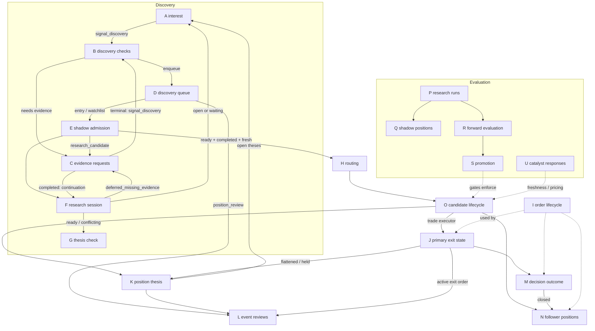

# State machines

Every long-lived process in this system moves records through states. This document lists each of those
state machines: its states, which module writes each transition, what drives it, and which other
modules read it. It ends with how the machines feed each other.

All state is in SQLite (`status` columns) except one: the primary account's exit orders live in the
option position state file (`WorkerPaths.option_position_state_path`).

**Ownership rule.** The *owner* module is the only one that should write a machine's transitions.
Readers listed below query the tables directly today. Before adding a new reader, prefer a function
on the owner.

Contents:

- [Who drives what](#who-drives-what)
- [Discovery and research](#discovery-and-research)
  - [A. Company interest](#a-company-interest)
  - [B. Discovery checks](#b-discovery-checks)
  - [C. Company evidence requests](#c-company-evidence-requests)
  - [D. Discovery queue](#d-discovery-queue)
  - [E. Shadow candidate admission](#e-shadow-candidate-admission)
  - [F. Research sessions](#f-research-sessions)
  - [G. Evidence thesis checks](#g-evidence-thesis-checks)
  - [H. Production routing](#h-production-routing)
- [Trading](#trading)
  - [I. Broker order lifecycle](#i-broker-order-lifecycle)
  - [J. Primary exit order state](#j-primary-exit-order-state)
  - [K. Position theses](#k-position-theses)
  - [L. Event thesis reviews](#l-event-thesis-reviews)
  - [M. Manager decision outcome](#m-manager-decision-outcome)
  - [N. Follower positions](#n-follower-positions)
  - [O. Candidate lifecycle](#o-candidate-lifecycle)
- [Evaluation and promotion](#evaluation-and-promotion)
  - [P. Research runs](#p-research-runs)
  - [Q. Research shadow positions](#q-research-shadow-positions)
  - [R. Forward evaluation](#r-forward-evaluation)
  - [S. Gate promotion and champion](#s-gate-promotion-and-champion)
  - [T. Research mark sessions](#t-research-mark-sessions)
  - [U. Catalyst responses](#u-catalyst-responses)
  - [V. Job runs](#v-job-runs)
- [How the machines interact](#how-the-machines-interact)
- [Invariants worth keeping](#invariants-worth-keeping)

## Who drives what

| Process | Entry point | Machines it advances |
| --- | --- | --- |
| News collector | [news_collector_main.py](../Python%20Scripts/news_collector_main.py) `run_news_collection_cycle` | U, R, A, C, B, D (discovery and watchlist items), E, F, G |
| Main worker | [main.py](../Python%20Scripts/main.py) → [worker_application.py](../Python%20Scripts/services/runtime/worker_application.py) `run_main_loop` | H, O, N (entries mirrored at execution), and J, K, L (position review items), M through option management |
| Option manager | [option_manager_main.py](../Python%20Scripts/option_manager_main.py) → `run_option_manager_loop` | J, K, L, M, N (follower management), T |
| EOD market data sync | [marketdata_eod_sync_main.py](../Python%20Scripts/marketdata_eod_sync_main.py) | V |
| Operator CLIs | `scripts/research.py`, `scripts/discovery.py`, `scripts/v2_part*.py` | P, Q, R, S (reports and promotion) |

The news collector cycle runs in this order: news → catalyst responses (U) → forward evaluation (R) →
market events → company evidence (C) → event discovery (B → D) → discovery research (D → E → F → G).

## Discovery and research

### A. Company interest

Which companies anything currently cares about. A row is **active** while
`selected_at <= now < expires_at`. There is no status column.

```text
(absent | expired) ──register_interest──▶ active ──expires_at passes──▶ expired
active ──register_interest again──▶ active (expiry pushed out)
```

Sources: `position_review` and `watchlist` (reconciled every cycle), `active_research`,
`pipeline_selection`, `opportunist`, `research_candidate`, `research_gap`.

| | Files |
| --- | --- |
| Table | `company_interest` ([company_interest_schema.sql](../Data/market_db_modules/company_interest_schema.sql)) |
| Owner | [Data/market_db_modules/company_interest.py](../Data/market_db_modules/company_interest.py) `register_interest`, `active_company_ids` |
| Driver | [services/discovery/company_interest.py](../Python%20Scripts/services/discovery/company_interest.py) `reconcile_company_interest`. It reads open theses (K) through [discovery_sources.py](../Data/market_db_modules/discovery_sources.py) `review_company_ids` and active research sessions (F). |
| Readers | [event_discovery.py](../Python%20Scripts/services/discovery/event_discovery.py), [company_evidence_demand.py](../Python%20Scripts/services/discovery/company_evidence_demand.py), [company_evidence_packages.py](../Python%20Scripts/services/discovery/company_evidence_packages.py), [discovery_routing.py](../Python%20Scripts/services/discovery/discovery_routing.py), [market_events.py](../Python%20Scripts/services/discovery/market_events.py), [evidence_research_policy.py](../Python%20Scripts/services/research/evidence_research_policy.py), [evidence_refresh.py](../Data/market_db_modules/evidence_refresh.py), [news_db_modules/provenance.py](../Data/news_db_modules/provenance.py), `scripts/discovery.py` |

New or revived interest calls `signal_discovery`, which re-arms B.

### B. Discovery checks

A per-company "scan this company again" flag.

```text
pending ──finish_discovery_check──▶ checked
pending ──finish_discovery_check(dependency)──▶ waiting_for_evidence   (dependency_request_id → C)
checked | waiting_for_evidence ──signal_discovery──▶ pending            (generation += 1)
```

A signal only arms a check while the company has active interest (A). `signal_discovery` is called by:
new interest (A), a new or changed company news article (`signal_company_news`), and a finished
evidence request (C). The finish step matches on `generation`, so a result for an older generation
does nothing.

| | Files |
| --- | --- |
| Tables | `discovery_checks`, `discovery_check_signals` ([company_interest_schema.sql](../Data/market_db_modules/company_interest_schema.sql)) |
| Owner | [Data/market_db_modules/company_interest.py](../Data/market_db_modules/company_interest.py) `signal_discovery`, `due_discovery_checks`, `finish_discovery_check` |
| Driver | [event_discovery.py](../Python%20Scripts/services/discovery/event_discovery.py) `discover_company_events`. It either enqueues evidence (C) and waits, or enqueues a discovery item (D). |
| Readers | `scripts/discovery.py` |

### C. Company evidence requests

Jobs to collect company evidence (filings, facts, packages).

```text
pending ──collect ok──▶ completed (package_id)
pending ──collect failed, attempts < 3──▶ pending (next_attempt_at = now + 60·2^attempts s)
pending ──collect failed, attempts ≥ 3──▶ unavailable
pending ──interest expired──▶ unavailable (interest_expired)
pending ──parent event superseded──▶ unavailable (event_superseded)
completed ──continuation not worth running──▶ completed with reason set (no_new_evidence, …)
```

Only requests still `pending` are updated. A request that arrives during a fetch stays pending.

| | Files |
| --- | --- |
| Table | `company_evidence_requests` ([company_collection_schema.sql](../Data/market_db_modules/company_collection_schema.sql)) |
| Owner | [Data/market_db_modules/evidence_refresh.py](../Data/market_db_modules/evidence_refresh.py) `enqueue_refresh`, `finish_refresh_requests` |
| Driver | [company_evidence_service.py](../Python%20Scripts/services/discovery/company_evidence_service.py) `collect_company_evidence` |
| Created by | discovery checks ([event_discovery.py](../Python%20Scripts/services/discovery/event_discovery.py)), research candidates ([discovery_candidates.py](../Data/market_db_modules/discovery_candidates.py)), research gaps ([research_runtime.py](../Data/market_db_modules/research_runtime.py)), news impacts ([news_db_modules/impacts.py](../Data/news_db_modules/impacts.py)), and pipeline selection and active interest ([company_evidence_demand.py](../Python%20Scripts/services/discovery/company_evidence_demand.py)) |
| Other writers | [company_evidence_demand.py](../Python%20Scripts/services/discovery/company_evidence_demand.py) (interest_expired, event_superseded), [research_continuation.py](../Python%20Scripts/services/research/research_continuation.py) (`reason`) |
| Readers | [services/discovery/company_interest.py](../Python%20Scripts/services/discovery/company_interest.py) |

A terminal request calls `signal_discovery` (→ B). A `completed` request with a `parent_session_id`
feeds a research continuation (F).

### D. Discovery queue

The central leased work queue. One item exists per (company, catalyst, evidence revision, purpose).

```text
pending ──claim──▶ running ──finish──▶ completed | deferred | expired | failed
deferred ──next_attempt_at due, claim──▶ running
running ──lease expired──▶ pending, or failed when attempts ≥ max_attempts
pending | deferred ──attempts ≥ max_attempts──▶ failed (retry_exhausted)
pending | deferred | running ──newer evidence_revision enqueued──▶ expired (superseded)
pending | deferred | running ──expires_at passed──▶ expired (stale_evidence)
```

Fencing: every write checks the item's `lease_token` (`require_discovery_lease`). A deferral backs off
`retry_seconds · 2^(attempts-1)`, or waits until `retry_at` when one is given.

Two consumers split the queue by `purpose`:

| Purpose | Consumer | Outcome |
| --- | --- | --- |
| `entry`, `watchlist` | [services/discovery/discovery_queue.py](../Python%20Scripts/services/discovery/discovery_queue.py) `run_discovery_research_cycle` → `claim_discovery_batch` | Shadow candidate (E) and research session (F) |
| `position_review` | [thesis_event_review.py](../Python%20Scripts/services/thesis/thesis_event_review.py) `EventThesisReviewService.run` → `claim_position_reviews` (after a debounce) | Event thesis reviews (L). `daily_limit_reached` defers to the next market day. |

| | Files |
| --- | --- |
| Tables | `discovery_queue` ([research_foundation_schema.sql](../Data/market_db_modules/research_foundation_schema.sql)); `discovery_queue_details`, `discovery_queue_origins`, `discovery_events` ([discovery_schema.sql](../Data/market_db_modules/discovery_schema.sql)) |
| Owner | [Data/market_db_modules/discovery_queue.py](../Data/market_db_modules/discovery_queue.py) `enqueue_discovery_event`, `claim_discovery_batch`, `claim_position_reviews`, `renew_discovery_lease`, `finish_discovery_item` |
| Producer | [event_discovery.py](../Python%20Scripts/services/discovery/event_discovery.py) |
| Readers | [research_runtime.py](../Data/market_db_modules/research_runtime.py) `research_event_superseded`, [research_foundation.py](../Data/market_db_modules/research_foundation.py), [research_outcomes.py](../Data/market_db_modules/research_outcomes.py), [discovery_evaluation.py](../Data/market_db_modules/discovery_evaluation.py), [discovery_routing.py](../Python%20Scripts/services/discovery/discovery_routing.py), [services/discovery/company_interest.py](../Python%20Scripts/services/discovery/company_interest.py), [decision_pipeline.py](../Python%20Scripts/agentCallers/decision_pipeline.py), [target_selection.py](../Python%20Scripts/agentCallers/agent_pipeline/target_selection.py), [existing_db_view.py](../Python%20Scripts/agentCallers/agent_pipeline/existing_db_view.py), `scripts/discovery.py` |

### E. Shadow candidate admission

A one-shot verdict written while a discovery item is leased: `ready` or `deferred`. It also claims the
research work: `research_work_owners` keeps one research session per work key (company, catalyst,
purpose, predecessor, inputs), so two intake routes for the same evidence share one session. Admission
also enqueues a `research_candidate` evidence request (C).

| | Files |
| --- | --- |
| Tables | `discovery_shadow_candidates` ([discovery_schema.sql](../Data/market_db_modules/discovery_schema.sql)), `research_work_owners` ([company_interest_schema.sql](../Data/market_db_modules/company_interest_schema.sql)) |
| Owner | [discovery_candidates.py](../Data/market_db_modules/discovery_candidates.py) `persist_discovery_candidate`, [research_work.py](../Data/market_db_modules/research_work.py) `claim_research_work` |
| Rule | [discovery_admission.py](../Python%20Scripts/services/discovery/discovery_admission.py) `evaluate_discovery_admission` |
| Readers | [discovery_routing.py](../Python%20Scripts/services/discovery/discovery_routing.py), [research_runtime.py](../Data/market_db_modules/research_runtime.py) `pending_research_candidates`, [discovery_evaluation.py](../Data/market_db_modules/discovery_evaluation.py) |

### F. Research sessions

A bounded, model-driven investigation of one discovery item.

```text
pending ──first model call──▶ running
running ──finish──▶ ready | conflicting_evidence | deferred_missing_evidence | budget_exhausted | superseded
```

- `superseded` happens when a newer revision of the event exists that the session's work key doesn't
  cover. This is checked before each step and again at finish.
- `ready` with no budget left becomes `budget_exhausted`.
- `deferred_missing_evidence` enqueues a `research_gap` evidence request (C). When that request
  completes, `prepare_research_continuations` records a **new** observation and session, linked by
  `research_evidence_continuations`. The parent session is never revised.
- While a session is open, or waiting on its evidence request, it keeps `active_research` interest (A)
  alive.
- `ready` and `conflicting_evidence` sessions go on to a thesis check (G).

The allowed status values are listed in [research_foundation_contracts.py](../Data/research_foundation_contracts.py).

| | Files |
| --- | --- |
| Tables | `research_sessions`, `research_steps` ([research_foundation_schema.sql](../Data/market_db_modules/research_foundation_schema.sql)); `research_session_progress`, `research_daily_allowances` ([research_runtime_schema.sql](../Data/market_db_modules/research_runtime_schema.sql)); `research_evidence_continuations` ([company_collection_schema.sql](../Data/market_db_modules/company_collection_schema.sql)) |
| Owner | [research_runtime.py](../Data/market_db_modules/research_runtime.py), [research_foundation.py](../Data/market_db_modules/research_foundation.py) |
| Driver | [research_orchestrator.py](../Python%20Scripts/services/research/research_orchestrator.py) `ResearchOrchestrator`; continuations in [research_continuation.py](../Python%20Scripts/services/research/research_continuation.py); planning in [research_planner.py](../Python%20Scripts/agentCallers/agent_stages/research_planner.py) |
| Readers | [services/discovery/company_interest.py](../Python%20Scripts/services/discovery/company_interest.py), [company_evidence_demand.py](../Python%20Scripts/services/discovery/company_evidence_demand.py), [research_outcomes.py](../Data/market_db_modules/research_outcomes.py), [evidence_thesis.py](../Data/market_db_modules/evidence_thesis.py), [evidence_thesis_report.py](../Data/market_db_modules/evidence_thesis_report.py), [research_thesis.py](../Python%20Scripts/services/research/research_thesis.py), [research_evidence.py](../Python%20Scripts/services/research/research_evidence.py) |

### G. Evidence thesis checks

A one-shot verdict on one model-authored thesis.

| Status | Meaning |
| --- | --- |
| `validated` | Every claim checked out |
| `validated_with_warnings` | Some non-blocking claims failed |
| `deferred` | Blocking failures |
| `invalid_output` | The thesis wasn't valid JSON of the right shape |
| `check_error` | The checker raised |
| `not_requested` | Skipped: the research status isn't eligible, or the event was superseded first |

The research route only checks sessions that are `ready` or `conflicting_evidence`
(`THESIS_RESEARCH_STATUSES`). A check counts as passing only for `validated` or
`validated_with_warnings` (`PASSING_STATUSES`).

| | Files |
| --- | --- |
| Tables | `evidence_thesis_checks`, `research_thesis_progress`, `research_thesis_allowances` ([evidence_thesis_schema.sql](../Data/market_db_modules/evidence_thesis_schema.sql)); `research_thesis_outcomes` ([forward_evaluation_schema.sql](../Data/market_db_modules/forward_evaluation_schema.sql)) |
| Rule | [services/thesis/evidence_thesis.py](../Python%20Scripts/services/thesis/evidence_thesis.py), [evidence_thesis_checks.py](../Python%20Scripts/services/thesis/evidence_thesis_checks.py) |
| Owner (persistence) | [Data/market_db_modules/evidence_thesis.py](../Data/market_db_modules/evidence_thesis.py) |
| Driver | [research_thesis.py](../Python%20Scripts/services/research/research_thesis.py) |
| Readers | [evidence_thesis_report.py](../Data/market_db_modules/evidence_thesis_report.py), [research_outcomes.py](../Data/market_db_modules/research_outcomes.py) (writes `research_thesis_outcomes`), [research_promotion.py](../Python%20Scripts/services/research/research_promotion.py) |

### H. Production routing

The bridge from discovery into the production pipeline when `DISCOVERY_MODE=enforce`. An entry is
routable only when all of these hold:

- the shadow candidate is `ready` (E);
- the queue item has `purpose='entry'` and is `completed` (D);
- the item hasn't expired;
- no route exists yet for that company and catalyst;
- company news was refreshed after admission;
- the catalyst passes the freshness rule.

Routing is recorded once per company and catalyst.

| | Files |
| --- | --- |
| Tables | `discovery_production_routes`, `discovery_news_refreshes` ([discovery_schema.sql](../Data/market_db_modules/discovery_schema.sql)) |
| Owner | [discovery_routing.py](../Python%20Scripts/services/discovery/discovery_routing.py) `admitted_entries`, `record_routes`, `record_news_refresh` |
| Driver | [decision_pipeline.py](../Python%20Scripts/agentCallers/decision_pipeline.py), [news_refresh.py](../Python%20Scripts/agentCallers/agent_pipeline/news_refresh.py) |
| Readers | [discovery_evaluation.py](../Data/market_db_modules/discovery_evaluation.py), [api_support/forward_evaluation.py](../api_support/forward_evaluation.py) |

## Trading

### I. Broker order lifecycle

Not a table. This is the one classification of a broker order status that every module waiting on an
order uses.

| Phase | Broker statuses |
| --- | --- |
| `working` | `new`, `accepted`, `accepted_for_bidding`, `pending_new`, `pending_replace`, `pending_cancel`, `pending_review`, `partially_filled`, `calculated`, `held`, `stopped`, `suspended`, and any unknown status (logged once) |
| `filled` | `filled` |
| `ended` | `canceled`, `cancelled`, `expired`, `rejected`, `done_for_day`. Read `filled_qty` for a partial fill. |
| `replaced` | `replaced`. Follow `replaced_by`. |

| | Files |
| --- | --- |
| Owner | [order_values.py](../Python%20Scripts/services/trading/order_values.py) `order_phase`, `WORKING_STATUSES`, `ENDED_STATUSES` |
| Callers | [_option_positions_state.py](../Python%20Scripts/trading_support/_option_positions_state.py) (J), [follower_fleet.py](../Python%20Scripts/services/trading/follower_fleet.py) (N), [outcome_reconciliation.py](../Python%20Scripts/services/trading/outcome_reconciliation.py) (M), [runtime/execution_telemetry.py](../Python%20Scripts/services/runtime/execution_telemetry.py), [Data/market_db_modules/execution_telemetry.py](../Data/market_db_modules/execution_telemetry.py) (`SETTLED_ORDER_STATUSES` adds `not_found`), [exposure_map.py](../api_support/exposure_map.py) |

Don't add a new status set in a caller. Branch on `order_phase`.

### J. Primary exit order state

The primary account's open exit order for each option contract. It is kept in the option position state
file, keyed by option symbol.

```text
no pending order ──exit submitted (sell_full | sell_partial)──▶ pending (pending_order_id, action, reason)
pending ──working──▶ pending   (stale past the timeout → cancel submitted)
pending ──replaced──▶ pending  (pending_order_id := replaced_by)
pending ──filled | ended──▶ no pending order
                              ended without a fill → scale-out flag rolled back, last_retryable_exit_* recorded
contract no longer held ──▶ entry deleted from the state file; symbol reported in flattened_symbols
```

| | Files |
| --- | --- |
| Store | [option_position_state.py](../Python%20Scripts/services/options/option_position_state.py) `get_position_state`, `update_position_state`, `delete_position_state` |
| Transitions | [_option_positions_state.py](../Python%20Scripts/trading_support/_option_positions_state.py) `_reconcile_pending_order_state`, `_mark_exit_submission` |
| Driver | [_option_positions_manager.py](../Python%20Scripts/trading_support/_option_positions_manager.py) `ManageCurrentOptionPositions`, called from [position_manager.py](../Python%20Scripts/services/options/position_manager.py) `run_cycle` |
| Exit rules | [_option_positions_strategy.py](../Python%20Scripts/trading_support/_option_positions_strategy.py), [_option_positions_snapshot.py](../Python%20Scripts/trading_support/_option_positions_snapshot.py), [position_exit_policy.py](../Python%20Scripts/services/options/position_exit_policy.py) |

`close_submitted` on a position summary means an exit order (full or partial) was submitted in this
cycle. It does **not** mean the position is flat.

### K. Position theses

The entry thesis of an open option position.

```text
(entry submitted) ──record_entry──▶ open
open ──contract held on an earlier cycle and gone now (flattened_symbols)──▶ closed
closed (latest row) ──contract still held and no open row──▶ open (reopened; closed_at cleared)
```

A thesis outlives its exit orders: a partial scale-out or an unfilled exit leaves it open. Expiry,
assignment and manual closes close it, because each one makes the contract disappear from holdings.

| | Files |
| --- | --- |
| Table | `position_theses` ([market_schema.sql](../Data/market_schema.sql)) |
| Owner | [Data/market_db_modules/thesis_validator.py](../Data/market_db_modules/thesis_validator.py) `record_position_thesis`, `close_position_thesis`, `reopen_position_thesis` |
| Driver | [thesis_capture.py](../Python%20Scripts/services/thesis/thesis_capture.py) `PositionThesisJournal.record_entry` / `record_flat` / `record_held`, called from [position_manager.py](../Python%20Scripts/services/options/position_manager.py) `_sync_theses_with_holdings` |
| Readers | [discovery_sources.py](../Data/market_db_modules/discovery_sources.py) `review_company_ids` (→ position-review interest, A), [position_exit_policy.py](../Python%20Scripts/services/options/position_exit_policy.py), [thesis_event_review.py](../Python%20Scripts/services/thesis/thesis_event_review.py), [thesis_validator_service.py](../Python%20Scripts/services/thesis/thesis_validator_service.py), [position_outcomes.py](../Data/market_db_modules/position_outcomes.py) |

### L. Event thesis reviews

A shadow review of an open thesis after a material event (a `position_review` queue item, D). One
record is kept per review attempt.

| Status | Meaning |
| --- | --- |
| `evaluated` | Reviewed. `thesis_state` is one of `intact`, `degraded`, `invalidated`, `unclear`. |
| `position_not_open` | Skipped: no open position |
| `rules_exit_precedence` | Skipped: the rules layer already decided to sell |
| `active_exit_order` | Skipped: an exit order is pending (J) |
| `no_new_evidence_since_entry` | Skipped: nothing new since entry |
| `coalesced` | Skipped: same evidence as an earlier review |
| `daily_limit_reached` | Not recorded. The queue item defers to the next market day. |

| | Files |
| --- | --- |
| Table | `thesis_event_reviews` ([thesis_event_reviews_schema.sql](../Data/market_db_modules/thesis_event_reviews_schema.sql)) |
| Owner | [Data/market_db_modules/thesis_event_reviews.py](../Data/market_db_modules/thesis_event_reviews.py) |
| Driver | [thesis_event_review.py](../Python%20Scripts/services/thesis/thesis_event_review.py) `EventThesisReviewService`, with policy in [thesis_event_review_policy.py](../Python%20Scripts/services/thesis/thesis_event_review_policy.py) |
| Related | The daily validator ([thesis_validator_service.py](../Python%20Scripts/services/thesis/thesis_validator_service.py), [thesis_validator_adjudicator.py](../Python%20Scripts/services/thesis/thesis_validator_adjudicator.py)) uses the same `thesis_state` values |
| Readers | `scripts/research.py` |

### M. Manager decision outcome

The realized outcome of one executed manager decision.

```text
(unset) ──P&L refresh──▶ open | exit_pending   (exit_pending while a managed exit is submitted)
open ⇄ exit_pending ──P&L refresh──▶ follows the latest position snapshot
open | exit_pending ──complete broker round trip──▶ closed
open | exit_pending ──fills can't be attributed safely──▶ ambiguous
```

`closed` and `ambiguous` are final.

| | Files |
| --- | --- |
| Column | `manager_decision_history.outcome_status` ([market_schema.sql](../Data/market_schema.sql)) |
| Owner | [history_records.py](../Data/market_db_modules/history_records.py) `update_manager_decision_latest_pnl`, `record_manager_decision_closed_outcome`, `mark_manager_decision_ambiguous` |
| Drivers | [position_manager.py](../Python%20Scripts/services/options/position_manager.py) `_refresh_manager_decision_history_pnl`; [outcome_reconciliation.py](../Python%20Scripts/services/trading/outcome_reconciliation.py) `reconcile_closed_outcomes` |
| Readers | [shadow_gates.py](../Data/market_db_modules/shadow_gates.py), [account_positions.py](../Data/market_db_modules/account_positions.py) `closed_source_orders` (→ N), [decision_expectancy.py](../api_support/decision_expectancy.py), [decision_autopsy.py](../api_support/decision_autopsy.py), [v2_status.py](../api_support/v2_status.py), [queries.py](../Data/market_db_modules/queries.py), [evidence_thesis_report.py](../Data/market_db_modules/evidence_thesis_report.py), [position_outcomes.py](../Data/market_db_modules/position_outcomes.py) |

### N. Follower positions

A follower account's copy of one primary entry.

```text
(primary entry seen) ──▶ skipped | pending_entry
pending_entry ──entry working──▶ pending_entry
pending_entry ──entry replaced──▶ pending_entry (entry_order_id := replaced_by)
pending_entry ──filled, or ended with a partial fill──▶ open
pending_entry ──ended with no fill──▶ failed
open ──exit reason (production_exit | expiry_guard | max_hold)──▶ closing
closing ──exit replaced──▶ closing (exit_order_id := replaced_by)
closing ──flat──▶ closed
closing ──ended with quantity left──▶ open (reopen with the remaining quantity)
```

`production_exit` fires once the follower has seen the primary hold the contract (`source_seen_at`)
and it no longer does, or once the primary's decision is `closed` (M).

| | Files |
| --- | --- |
| Table | `account_positions` ([account_positions_schema.sql](../Data/market_db_modules/account_positions_schema.sql)) |
| Owner | [account_positions.py](../Data/market_db_modules/account_positions.py) `record_plan`, `mark_entry_order`, `mark_entry_fill`, `mark_failed`, `mark_closing`, `reopen`, `mark_closed` |
| Driver | [follower_fleet.py](../Python%20Scripts/services/trading/follower_fleet.py) `FollowerFleet.mirror_entry` (from [trade_executor.py](../Python%20Scripts/services/trading/trade_executor.py)), `FollowerFleet.manage` |
| Readers | [api_routes/dashboard.py](../api_routes/dashboard.py), `scripts/account_report.py` |

The owner's setters don't check the current state; the driver decides transitions.

### O. Candidate lifecycle

An append-only stage log, not a status column. `begin_candidate` creates the candidate. Each stage
writes a snapshot, and a rejection records the stage and its reason code. Telemetry failures never
change a trading verdict.

| | Files |
| --- | --- |
| Tables | `candidates`, `candidate_snapshots`, `candidate_rejections`, `candidate_catalysts` |
| Owner | [Data/market_db_modules/candidate_lifecycle.py](../Data/market_db_modules/candidate_lifecycle.py) |
| Driver | [services/runtime/candidate_lifecycle.py](../Python%20Scripts/services/runtime/candidate_lifecycle.py) `begin_candidate`, `checkpoint`, `reject`; gates in [services/gates/](../Python%20Scripts/services/gates/) |

## Evaluation and promotion

### P. Research runs

```text
open ──target_candidates enrolled, or enrollment window + grace passed──▶ sealed
```

A candidate whose inputs fail validation **pauses** the whole run, recorded as a row in
`research_run_pauses` rather than as a status. A later collection that succeeds clears the pause.

| | Files |
| --- | --- |
| Tables | `research_runs`, `research_run_pauses`, `research_candidates`, `research_reports` ([research_schema.sql](../Data/market_db_modules/research_schema.sql)) |
| Owner | [research_runs.py](../Data/market_db_modules/research_runs.py) |
| Drivers | [research_marks.py](../Python%20Scripts/services/research/research_marks.py), [catalyst_response_collector.py](../Python%20Scripts/services/discovery/catalyst_response_collector.py), `scripts/v2_part*.py` |
| Readers | [research_reports.py](../Data/market_db_modules/research_reports.py) (sealed `frozen_forward` runs only), [forward_comparison.py](../Data/market_db_modules/forward_comparison.py), [forward_evaluation.py](../Data/market_db_modules/forward_evaluation.py), [challenger_evaluation.py](../Python%20Scripts/services/evaluation/challenger_evaluation.py), [research_versions.py](../Python%20Scripts/services/research/research_versions.py), [v2_status.py](../api_support/v2_status.py) |

### Q. Research shadow positions

Each enrolled candidate's hypothetical trade, one per strategy.

```text
pending ──▶ missing_decision | cash | missing_benchmark_prices | missing_reference_trade | complete
```

`complete` and `cash` are final, and are never overwritten. Other statuses are recomputed at later
collections. A run keeps being collected while it is `open` or still has positions that aren't final.

| | Files |
| --- | --- |
| Table | `research_shadow_positions` ([research_schema.sql](../Data/market_db_modules/research_schema.sql)) |
| Owner | [research_runs.py](../Data/market_db_modules/research_runs.py) |
| Rule | [shadow_portfolio.py](../Python%20Scripts/services/research/shadow_portfolio.py) |
| Readers | [research_marks.py](../Python%20Scripts/services/research/research_marks.py), [forward_comparison.py](../Data/market_db_modules/forward_comparison.py), [forward_evaluation.py](../Data/market_db_modules/forward_evaluation.py), [research_reports.py](../Data/market_db_modules/research_reports.py) |

### R. Forward evaluation

| Record | States |
| --- | --- |
| `decision_observations` | `recorded` \| `unavailable` (one-shot) |
| `paired_evaluations` | `pending` → `evaluated` \| `abstained` \| `unavailable`; final statuses are never overwritten, and `attempts` counts retries |
| `strategy_evaluations` | `evaluated` \| `abstained` \| `unavailable` (one-shot) |

A forward comparison needs every run in its cohort `sealed` (P).

| | Files |
| --- | --- |
| Tables | [forward_evaluation_schema.sql](../Data/market_db_modules/forward_evaluation_schema.sql); `strategy_evaluations` in [research_foundation_schema.sql](../Data/market_db_modules/research_foundation_schema.sql) |
| Owners | [forward_evaluation.py](../Data/market_db_modules/forward_evaluation.py), [forward_comparison.py](../Data/market_db_modules/forward_comparison.py), [research_observations.py](../Data/market_db_modules/research_observations.py) |
| Drivers | [services/evaluation/forward_evaluation.py](../Python%20Scripts/services/evaluation/forward_evaluation.py) `run_forward_evaluation_cycle`, [challenger_evaluation.py](../Python%20Scripts/services/evaluation/challenger_evaluation.py), [decision_observations.py](../Python%20Scripts/services/evaluation/decision_observations.py), [forward_cohorts.py](../Python%20Scripts/services/evaluation/forward_cohorts.py), [decision_pipeline.py](../Python%20Scripts/agentCallers/decision_pipeline.py) |
| Readers | [api_support/forward_evaluation.py](../api_support/forward_evaluation.py), [demo_mode.py](../api_support/demo_mode.py) |

### S. Gate promotion and champion

A gate stage runs in `shadow` unless its policy says `enforce`. `enforce` is allowed only while
`research_gate_promotions` holds a row for that stage whose `policy_hash` matches, with
`gate_value > 0` and `sample_size >= 100`. `policy_hash` covers the policy values and the hash of the
gate's source files (`GATE_FILES`). Changing a gate's code changes the hash, which revokes its approval.

`research_champion` is a single row naming the production strategy identity. `champion_check` compares
a candidate's manifest against it.

| | Files |
| --- | --- |
| Tables | `research_gate_promotions`, `research_champion` ([research_schema.sql](../Data/market_db_modules/research_schema.sql)) |
| Owner | [research_promotion.py](../Python%20Scripts/services/research/research_promotion.py) `approved`, `guard_policy`, `champion_check`, `champion_allows` |
| Writers | [research_reports.py](../Data/market_db_modules/research_reports.py), [research_runs.py](../Data/market_db_modules/research_runs.py), `scripts/v2_part6.py` |
| Readers | [benchmarks.py](../Data/market_db_modules/benchmarks.py), [v2_status.py](../api_support/v2_status.py) |

### T. Research mark sessions

One per market day: `running` → `complete` | `failed`. A second attempt on the same day returns
`already_ran`.

| | Files |
| --- | --- |
| Table | `research_mark_sessions` ([forward_evaluation_schema.sql](../Data/market_db_modules/forward_evaluation_schema.sql)) |
| Owner | [forward_evaluation.py](../Data/market_db_modules/forward_evaluation.py) `finish_mark_session` |
| Driver | [research_marks.py](../Python%20Scripts/services/research/research_marks.py) `collect_research_marks`, called from [worker_application.py](../Python%20Scripts/services/runtime/worker_application.py) `_run_due_research_marks` in the option manager loop |

### U. Catalyst responses

The price response to each catalyst at each horizon.

```text
pending_horizon | missing_event_time | missing_regression_history | missing_aligned_prices ──recomputed──▶ complete
```

`complete` is final: the upsert skips rows that are already `complete`.

| | Files |
| --- | --- |
| Tables | `catalyst_responses`, `catalyst_response_events` ([pricing_schema.sql](../Data/market_db_modules/pricing_schema.sql)) |
| Owner | [pricing_research.py](../Data/market_db_modules/pricing_research.py) |
| Rule | [price_response.py](../Python%20Scripts/services/research/price_response.py) |
| Driver | [catalyst_response_collector.py](../Python%20Scripts/services/discovery/catalyst_response_collector.py) |
| Readers | [research_tools.py](../Python%20Scripts/services/research/research_tools.py), [discovery_evaluation.py](../Data/market_db_modules/discovery_evaluation.py), [pricing_gates.py](../Python%20Scripts/services/gates/pricing_gates.py) (through `catalyst_stats`) |

### V. Job runs

Simple `running` → `completed` | `failed` records.

| Table | Owner |
| --- | --- |
| `backtest_runs` | [backtesting.py](../Data/market_db_modules/backtesting.py) |
| `marketdata_eod_sync_runs` | [marketdata_sync.py](../Data/market_db_modules/marketdata_sync.py) |
| `historical_option_quote_fetch_runs` | [backtest_marketdata.py](../Data/market_db_modules/backtest_marketdata.py) |

## How the machines interact



The loops worth knowing:

1. **Interest ↔ checks ↔ evidence.** Interest arms a check. The check waits on evidence. Finished
   evidence re-arms the check. All three loops stop when interest expires.
2. **Research ↔ evidence.** A session missing evidence asks for it. The completed request starts a
   linked continuation session, and the session keeps its company's interest alive meanwhile.
3. **Position ↔ discovery.** An open thesis (K) creates position-review interest (A) → queue items (D)
   → event reviews (L). The thesis follows holdings (J), so the loop runs exactly while the contract is
   held.
4. **Supersede.** A new `evidence_revision` expires older queue items (D) at enqueue time. Sessions (F),
   thesis checks (G), continuations (F) and evidence requests (C) find out later through
   `research_event_superseded`. A running session survives a revision its work key already covers.

## Invariants worth keeping

- **Stale writes are rejected.** D checks `lease_token`, B checks `generation`, and C and J only update
  rows still `pending` or still pointing at the same order.
- **Final states are final.** `paired_evaluations` (evaluated, abstained, unavailable), shadow positions
  (complete, cash), catalyst responses (complete) and decision outcomes (closed, ambiguous) are never
  overwritten.
- **History is not revised.** Continuations create new sessions, and a new evidence revision creates a
  new queue item.
- **Order status means one thing.** Classify broker statuses only through `order_phase` (I).
- **A thesis follows holdings, not orders.** Don't close a thesis on `close_submitted` (K).
