# System Diagram

How the whole repository fits together, drawn from the code as it runs today.
Each section zooms in on one part of the system; the file and function names in
the nodes are where to start reading. See [ARCHITECTURE.md](ARCHITECTURE.md) for
where new code belongs and [CODE_MAP.md](CODE_MAP.md) for the folder map.

1. [Runtime topology](#1-runtime-topology) — containers, external services, shared state
2. [News collector loop](#2-news-collector-loop) — scrape, classify, rank, collect evidence
3. [Worker trading loop](#3-worker-trading-loop) — schedule, exposure caps, streaming vs batch
4. [Per-company decision pipeline](#4-per-company-decision-pipeline) — strategist → manager → gates → order
5. [Order execution guardrails](#5-order-execution-guardrails) — what can still stop a buy
6. [Option position management](#6-option-position-management) — exits, thesis validation, outcomes
7. [Research and discovery (shadow)](#7-research-and-discovery-shadow) — never places orders
8. [Data layer](#8-data-layer) — SQLite modules and import surfaces
9. [API and dashboard](#9-api-and-dashboard) — what the UI reads
10. [LLM provider layer](#10-llm-provider-layer) — which stages call a model

---

## 1. Runtime topology

Docker Compose ([docker-compose.yml](../docker-compose.yml)) runs every Python
service from the same image (`Dockerfile.worker`). They share one SQLite file on
the `db_data` volume and exchange status JSON on the `runtime_data` volume.

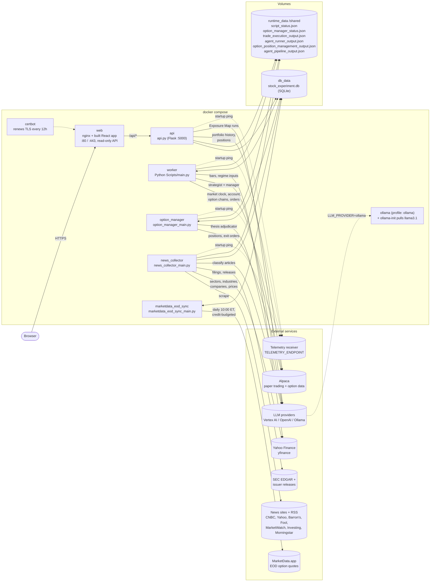

---

## 2. News collector loop

`news_collector_main.py` runs every `NEWS_COLLECTION_INTERVAL_SECONDS` (3h by
default). The scrape itself is in `agent_pipeline/news_refresh.py`
(`run_news_collection_pipeline`); each scrape runs in a subprocess so a crashing
browser can't take down the loop. Everything the worker trades on later is
written to the DB here.

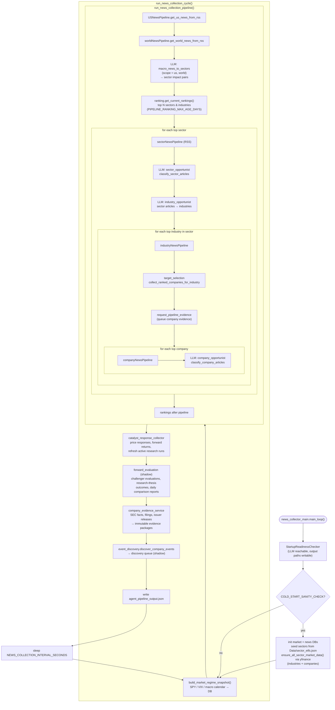

Inside every `*NewsPipeline` call above, the `Python Scripts/Webscraping` package
does the fetching and parsing:

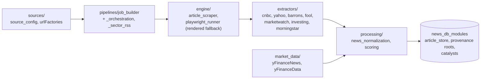

---

## 3. Worker trading loop

`Python Scripts/main.py` wires the services together and hands off to
`WorkerApplication.run_main_loop()`
([services/runtime/worker_application.py](../Python%20Scripts/services/runtime/worker_application.py)).
The worker reads the pipeline state the collector already wrote; it does not scrape.

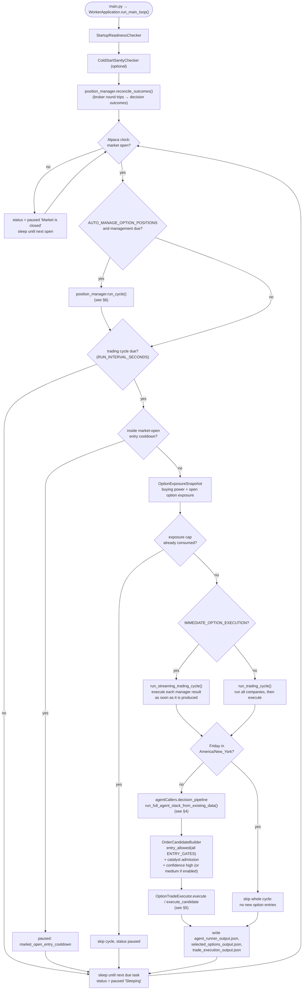

---

## 4. Per-company decision pipeline

`_run_strategist_and_manager()` in
[agentCallers/decision_pipeline.py](../Python%20Scripts/agentCallers/decision_pipeline.py). LLMs only
explain and classify grounded inputs; every go/no-go is a deterministic gate.
Every step writes a `candidate_lifecycle` checkpoint so a decision can be replayed
and audited later.

```mermaid
flowchart TD
    targets["run_agent_pipeline_from_existing_data()<br/>current sector → industry → company targets from DB"] --> dshadow["run_discovery_shadow_cycle()<br/>(shadow only, see §7)"]
    dshadow --> filt["_filter_company_symbols_by_high_confidence_support<br/>≥ MIN high-confidence recent articles"]
    filt --> prep["once per cycle:<br/>build_market_regime_snapshot()<br/>request_pipeline_evidence(scope=manager)<br/>build_pipeline_version() (config/model/prompt hashes)<br/>EvidenceThesisPolicy.from_env()"]
    prep --> each

    subgraph each["for each company symbol"]
        direction TB
        disc{"discovery-shadow<br/>candidate?"} -->|yes| skipd["skip (never traded)"]
        disc -->|no| begin["begin_candidate → candidate_id<br/>(opens the forward cohort first)"]
        begin --> adm{"catalyst_admission_allowed?<br/>(provenance, freshness decay)"}
        adm -->|no| blocked["checkpoint admission_blocked"]
        adm -->|yes| strat

        subgraph strat["STRATEGIST — agent_stages/strategist_runner.decide_company_purchase"]
            direction TB
            sp["agent_builders/strategist_payload*<br/>articles, company facts, price,<br/>sector/industry rollups, regime,<br/>company evidence package"]
            sp --> sllm["LLM (STRATEGIST_MODEL)<br/>JSON schema: buy / do_not_buy,<br/>confidence, evidence_thesis"]
            sllm --> sg["strategist_grounding<br/>validate cited article ids"]
            sg --> sn["strategist_normalization<br/>+ evidence_thesis checks"]
            sn --> ssave["record_strategist_run,<br/>add_strategist_company_summary"]
        end

        strat --> mgr

        subgraph mgr["MANAGER — agent_stages/manager_runner.decide_company_option_position"]
            direction TB
            mp["agent_helpers/manager.build_manager_input<br/>+ market_context: underlying bars & indicators,<br/>IV history, option chain (Alpaca), account"]
            mp --> ev{"payload has<br/>evidence?"}
            ev -->|no| noev["no-evidence result (neither)"]
            ev -->|yes| sd{"strategist answered<br/>watchlist / do_not_trade?"}
            sd -->|yes| noev2["strategist-declined result (neither),<br/>no model call"]
            sd -->|no| mllm["LLM (MANAGER_MODEL)<br/>call / put / neither,<br/>thesis/timing/execution confidence,<br/>target DTE bucket"]
            noev2 --> cont
            mllm --> mnorm["manager_normalization"]
            mnorm --> cont["evaluate_evidence_continuation_gate<br/>→ entry_gate (CONTINUATION)"]
            noev --> cont
        end

        mgr --> gates
        mgr -. "challenger on" .-> freeze["freeze decision observation<br/>model inputs + every bucket's chain<br/>(shadow, §7)"]

        subgraph gates["_apply_post_manager_gates (deterministic)"]
            direction TB
            hurdle["option_hurdle_gate<br/>expected vs implied move (shadow)"]
            scen["scenario_selector.prepare_scenario_inputs"]
            sel["deterministic_option_selector<br/>filters → greeks → volatility →<br/>simple / hybrid ranking,<br/>liquidity_gate"]
            reg["market_regime_gate<br/>→ REGIME verdict"]
            thes["evaluate_evidence_thesis_gate<br/>→ EVIDENCE_THESIS verdict"]
            econ["trade_economics (finalizer)<br/>Black-Scholes on empirical catalyst scenarios<br/>→ immutable report + TRADE_ECONOMICS verdict"]
            hurdle --> scen --> sel --> reg --> thes --> econ
        end

        gates --> hist["record_manager_decision_history"]
        hist --> cb["on_manager_result callback<br/>(streaming mode executes now)"]
        cb --> done["checkpoint candidate_complete"]
    end

    each --> result["selected_options output<br/>strategist[], manager[], failed_companies[]"]
    each -. "MAX_CONSECUTIVE_COMPANY_FAILURES<br/>→ stop cycle (shared outage)" .-> result
```

The gate registry is [services/gates/entry_gates.py](../Python%20Scripts/services/gates/entry_gates.py):

| Gate | Result key | Missing verdict |
| --- | --- | --- |
| `CONTINUATION` | `entry_gate` | blocks |
| `REGIME` | `market_regime_gate` | blocks |
| `EVIDENCE_THESIS` | `evidence_thesis_gate` | allowed (optional gate) |
| `TRADE_ECONOMICS` | `trade_economics_gate` | allowed (optional gate; attached to every directional result while on) |

---

## 5. Order execution guardrails

`OptionTradeExecutor` in
[services/trading/trade_executor.py](../Python%20Scripts/services/trading/trade_executor.py).
A candidate that passed every entry gate can still be skipped here.

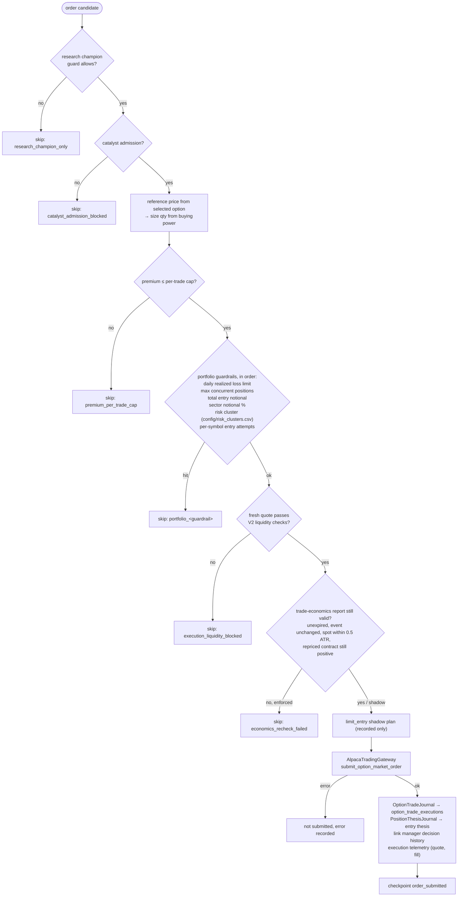

---

## 6. Option position management

Runs in the dedicated `option_manager` container (`run_option_manager_loop`),
and in the worker too if `WORKER_AUTO_MANAGE_OPTION_POSITIONS=true`.
`OptionPositionManagerService.run_cycle()` in
[services/options/position_manager.py](../Python%20Scripts/services/options/position_manager.py)
drives `trading_support/_option_positions_*`.

```mermaid
flowchart TD
    start(["option_manager_main → run_option_manager_loop()"]) --> recon["reconcile_outcomes()<br/>outcome_reconciliation: closed broker round trips"]
    recon --> open{"market open?"}
    open -->|no| wait["paused, sleep"] --> open
    open -->|yes| snap["snapshot open option positions<br/>+ quotes, DTE, P/L, momentum history"]
    snap --> ladder

    subgraph ladder["exit ladder — _option_positions_strategy (first matching rung wins)"]
        direction TB
        e0["data_invalid / no_position_qty /<br/>recent_fill_reconciliation / pending_exit_order → hold"]
        e1["stop_loss<br/>(with underlying-hold and pending-confirmation variants)"]
        e2["near_expiration<br/>(entry bucket's forced-exit DTE)"]
        e3["static_take_profit"]
        e4["trailing_profit_stop"]
        e5["first / second scale-out trigger<br/>(partial sells)"]
        e6["V2 rungs: catalyst time expiry,<br/>volatility collapse (position_exit_policy)"]
        e7["hold"]
        e0 --> e1 --> e2 --> e3 --> e4 --> e5 --> e6 --> e7
    end

    ladder --> orders["Alpaca: limit sell (spread-aware tick rounding)<br/>or market sell / close position;<br/>cancel stale exit orders"]
    orders --> jr["trade journal: record_position_exit<br/>thesis journal: record_exit<br/>refresh decision-history P/L<br/>position_telemetry (extrema, exit attribution)"]
    jr --> tv

    subgraph tv["ThesisValidatorService.run_due_validation"]
        direction TB
        pack["thesis_evidence_pack<br/>(entry thesis + new articles)"] --> adj["LLM: thesis_adjudicator<br/>multiple grounded samples<br/>+ consistency gate"]
        adj --> arb["thesis_arbiter<br/>hold / close half / close"]
    end

    tv --> er

    subgraph er["EventThesisReviewService.run (shadow, Phase 6)"]
        direction TB
        claim["claim 1 settled position_review item<br/>(discovery queue, 15-min debounce)"] --> skip{"rules exit, working order,<br/>no new evidence, same evidence,<br/>daily limit?"}
        skip -->|no| epack["event evidence pack<br/>(trigger articles first,<br/>previous verdict, Phase 4 thesis)"]
        epack --> eadj["LLM: thesis_adjudicator"] --> earb["thesis_arbiter →<br/>would-be action only"]
        skip -->|yes| erec["record status, no model call"]
        earb --> erec2["thesis_event_reviews<br/>(what changed and why)"]
    end

    er --> marks["research closing marks (shadow, ~10 min before close)<br/>Alpaca quotes for open research positions"]
    marks --> outw["write option_position_management_output.json<br/>status → option_manager_status.json"]
    outw --> open
```

---

## 7. Research and discovery (shadow)

These subsystems measure and compare strategies. They are disabled or
shadow-only by default and **do not feed broker execution**; the only link back to
live trading is the research-promotion champion guard checked in §5. See
[RESEARCH_PHASE0–7](README.md) and `scripts/v2_part*.py`. Paired forward evaluations
(`paired:` candidates) and discovery intake (`discovery:`) are refused by the order
builder and the champion guard.

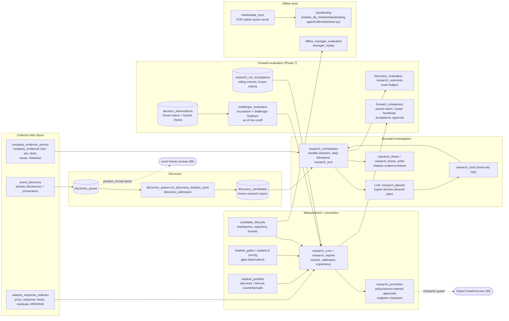

---

## 8. Data layer

One SQLite file (`DB_PATH`). Schemas are additive, idempotent
`CREATE ... IF NOT EXISTS` migrations applied at startup.

```mermaid
flowchart TD
    callers["pipelines, agent stages, services,<br/>api_support, scripts/*.py"] --> helpers

    subgraph helpers["Shared"]
        dbc["Data/db_common.py<br/>(current database, connection, setup)"]
    end

    subgraph mmods["Data/market_db_modules/"]
        direction TB
        m1["entities, snapshots, loaders, queries<br/>sectors · industries · companies · rankings"]
        m2["trade_executions, history_records/links,<br/>position_outcomes, execution_telemetry,<br/>manager_replay, autopsy, portfolio_risk"]
        m3["candidate_lifecycle, shadow_gates,<br/>catalyst_research, pricing_research,<br/>contract_research, market_regime"]
        m4["company_evidence, company_collection,<br/>company_interest, evidence_refresh,<br/>evidence_thesis(_report), thesis_validator"]
        m5["discovery_queue/sources/candidates,<br/>research_foundation/runtime/runs/reports/work,<br/>research_observations, foundation_store"]
        m6["backtesting, backtest_imports,<br/>backtest_marketdata, marketdata_sync,<br/>marketdata_budget, refresh_state"]
    end

    subgraph nmods["Data/news_db_modules/"]
        direction TB
        n1["article_store, entity_articles,<br/>links"]
        n2["macro, impacts, processing<br/>(opportunist classifications)"]
        n3["provenance (source roots),<br/>catalysts (state + decay)"]
        n4["strategist_runs"]
    end

    mmods & nmods --> dbc

    subgraph schema["Schemas"]
        s1["market_schema.sql + *_schema.sql modules"]
        s2["news_schema.sql"]
        s3["catalyst_schema.sql / catalyst_models.py"]
    end
    mmods --> sqlite[("stock_experiment.db")]
    nmods --> sqlite
    schema --> sqlite
```

---

## 9. API and dashboard

The React app (`web_dashboard/src`, built with Vite, served by nginx) calls the
Flask API. Routes live in `api_routes/` (request parsing only) and delegate to
`api_support/` (data shaping, no Flask objects).

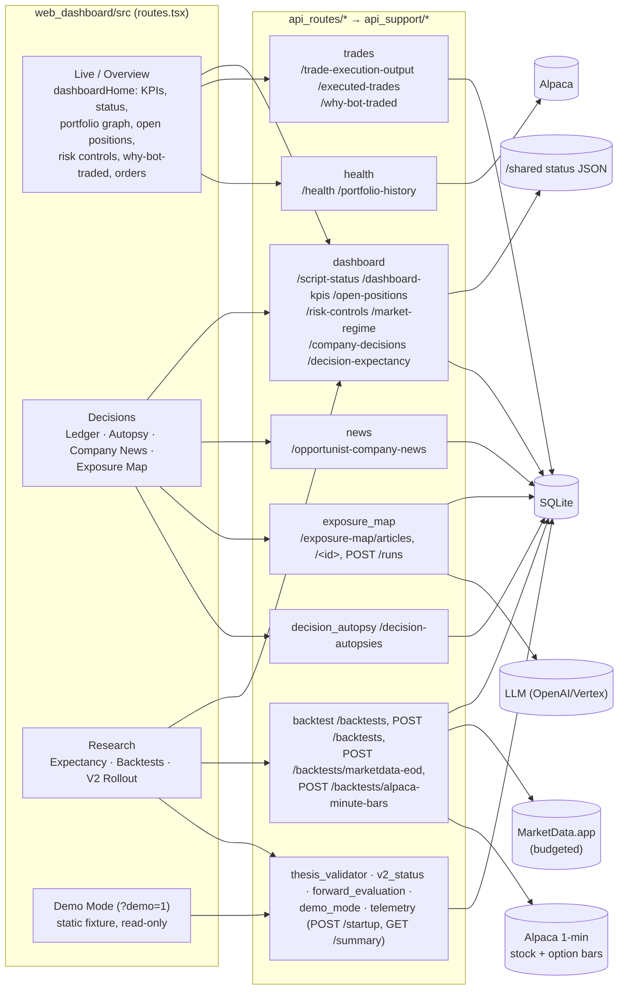

---

## 10. LLM provider layer

All model calls go through `agent_helpers/llm_client.py`
(`get_model_client`, `ask_llm_model`; the providers live in `llm_vertex.py` and `llm_openai.py`,
errors in `llm_errors.py`, usage records in `llm_usage.py`), which picks Vertex AI, the Gemini API (AI Studio key),
OpenAI, llama.cpp or Ollama from each stage's `<STAGE>_PROVIDER`, falling back to `LLM_PROVIDER`,
and the per-stage model settings in `services.core.settings.get_settings()`. The news classifiers call
`ask_classifier_model()`, which moves a quota-refused call down the `CLASSIFIER_FALLBACKS` models in order and returns
the model that answered, for storage with the classification.

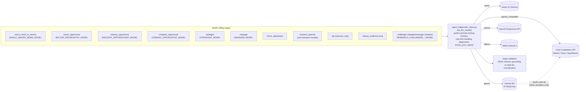
